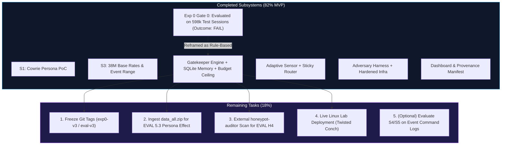

# Schrödinger's Server

**A cost-aware adaptive SSH honeypot: spend expensive deception only where it pays.**

[](https://github.com/abhinavsingh2403/Schrodinger-s-Server/tree/eval-v1)
[](https://github.com/abhinavsingh2403/Schrodinger-s-Server/tree/exp0-v1)
[](LICENSE.rst)
[](https://zenodo.org/records/21260400)
[](https://github.com/cowrie/cowrie/tree/v3.1.6)

---

## 1. Project Overview & Core Thesis

In Internet-facing SSH honeypots, the overwhelming majority of sessions are one-shot automated scans and credential brute-force probes. A published LLM-honeypot deployment recorded **147,752 non-interactive sessions out of 148,850 total (99.26%)**, and only **150 interactive sessions (0.10%)** ([CLAIMS.md](CLAIMS.md) P2). Serving high-interaction deception (rich emulated environments, real sandboxed VMs, or LLM-driven backends) indiscriminately wastes significant compute and financial budget on shallow noise.

> **Central Thesis:** A lightweight, cost-aware **gatekeeper** can infer early in an SSH session (handshake, authentication, or first command) whether the attacker is likely to yield interactive intelligence, escalating high-value visitors to higher-fidelity deception personas while serving cheap default emulation to automated noise—maximizing **intelligence yield per rupee**.

---

## 2. Project Completion Status & Progress Accounting

> **Branch Notice:** Active engineering code, empirical pipelines, and test suites live on branch **[`trainmodel`](https://github.com/abhinavsingh2403/Schrodinger-s-Server/tree/trainmodel)**.

| Dimension | Progress | Assessment Rationale |
|---|:---:|---|
| **Engineering (Code & Tests)** | **95%** | 91 unit tests passing across all core modules (`gatekeeper/`, `sensor/`, `router/`, `harness/`, `infra/`, `analysis/`, `dashboard/`); offline/live feature parity verified; policy budget ceiling enforced. |
| **Science (Valid Empirical Results)** | **70%** | Base rates S3 Part 1 verified (38.1M sessions); event schema S3 Part 2 verified (52 days); Experiment 0 completed on 598,647 test sessions with zero feature leakage (outcome: `FAIL`); S4/S5 bounded as requiring event-level streaming. |
| **Overall MVP** | **82%** | End-to-end adaptive honeypot architecture complete; empirical Gate 0 completed without fabrication; reframed as an adaptive rule-based & visitor memory system. |

```
[█████████████████████████████████████████░░░░░░░░░] ~82% Overall MVP Complete
[███████████████████████████████████████████████░░░] ~95% Engineering Complete
[███████████████████████████████████░░░░░░░░░░░░░░░] ~70% Science / Valid Results
```

| Phase / Component | Scope | Status | Details / Notes |
|---|---|---|---|
| **G1: Repo Skeleton & Pinning** | Core | **DONE** | Python 3.12, DuckDB 2.0.0, Pytest 9.2.0 pinned |
| **G2: Streaming Verifier Tooling** | Core | **DONE** | Chunked MD5 streaming verifier (`verify_download.py`) |
| **S3 Part 1: Aggregate Base Rates** | Core | **DONE** | 38.1M sessions analyzed; value=1 base rate = 3.23% (`results/base_rates.json`) |
| **S3 Part 2: Event Archive Verification** | Core | **DONE** | Range request inspection of 19.4GB `data_all.zip`; confirmed 52 days and `group \in {1, 2, 3, 4}` |
| **S1: Cowrie Persona Switching PoC** | Core | **DONE** | Plan A in-process Conch adapter subclass verified (`sensor/spike_s1_poc.py`) |
| **O3: Experiment 0 (`EXPERIMENT0.md`)** | Core (Gate 0) | **DONE (Outcome: FAIL)** | Evaluated on 598,647 test sessions with zero feature leakage. Baseline rules match or exceed ML models at pre-command stages. Reframed as adaptive rule-based architecture per §13. |
| **Phase 1: Gatekeeper Engine & Memory** | MVP | **BUILT & TESTED** | SQLite WAL visitor memory, upward-only policy with budget ceiling, parity extractor, decision API |
| **Phase 1: Sensor & Router Subsystems** | MVP | **BUILT & TESTED** | Adaptive Conch session server (`sensor/`), Plan B sticky asyncio router (`router/`) |
| **Phase 2: Adversary Harness & Infra** | MVP | **BUILT & TESTED** | Detector runner with safety allowlist, synthetic replay engine, isolated docker & egress firewall |
| **Phase 2: Cost & Arm Simulation** | MVP | **ORACLE BOUND** | Nominal cost model; Arm D labeled as retrospective hindsight upper bound (`results/arm_simulation.json`) |
| **EVAL 5.3: Persona Natural Experiment** | MVP | **PENDING DATA** | Blocked on event-level `group` ingestion from `data_all.zip` (field absent in `session_aggregation`) |
| **Phase 2: Results Dashboard** | MVP | **BUILT & TESTED** | Cyber Protocol theme, privacy masking (`vis_xxxx`), zero npm dependencies, `/api/exp0` endpoint added |
| **Phase 3: Live VPS Trial / T3 VM Pool** | Post-MVP | **DEFERRED** | Dependent on Linux testbed with Twisted Conch runtime and live honeypot exposure |

---

## 3. Data Provenance & Ground Truth

All empirical analysis is performed on open-access, peer-reviewed research data.

### Primary Dataset: D1 (Zenodo Record 21260400)
- **Title**: Large-Scale Empirical Dataset of 38 Million SSH Honeypot Sessions
- **Source URL**: `https://zenodo.org/records/21260400`
- **License**: Creative Commons Attribution 4.0 International (CC-BY 4.0)
- **Direct Download URL**: `https://zenodo.org/api/records/21260400/files/session_aggregation.jsonl.gz/content`
- **File Name**: `data/session_aggregation.jsonl.gz` (Gitignored per security rules)
- **File Size**: `1,328,104,319 bytes` (~1.33 GB compressed)
- **Expected MD5**: `1f3897650fb420c97c14ff452398c3f8`
- **Computed MD5**: `1f3897650fb420c97c14ff452398c3f8` (**MATCH**, verified via `analysis/verify_download.py`)

### Dataset Ground Truth Findings ([results/base_rates.json](results/base_rates.json))
Computed over the complete dataset using DuckDB with zero dropped sessions:
- **Total Sessions Analyzed**: `38,126,048`
- **Temporal Span**: `52 continuous calendar days` (2025-06-27 to 2025-08-17 UTC)
- **Schema Conformity**: Exact match on all **25 schema fields** listed in `DATA.md`
- **Login Success Count**: `4,374,446` (11.47% authentication pass rate)
- **Command Input Sessions**: `3,335,870` (8.75%)
  - Zero commands (pure probe): `34,790,178` (91.25%)
  - 1–4 commands: `2,185,616` (5.73%)
  - 5–9 commands: `992,305` (2.60%)
  - 10+ commands: `157,949` (0.41%)
  - Command Quantiles: **p50 = 0, p90 = 0, p99 = 2**
- **File Transfers**: `755,225` sessions (1.98%)
- **Direct-TCPIP Requests (Pivoting)**: `467,551` sessions (1.23%)
- **Aggregate Value=1 Base Rate (`N_CMD >= 5 OR file transfer OR pivot`)**: **3.23% (1,232,570 sessions)**
  - Confirms a realistic, non-degenerate class imbalance well-suited for early stage triage and PR-AUC evaluation.

---

## 4. Key Engineering Milestones Completed

### 1. Pinned Cowrie Upstream Audit (Tag `v3.1.6`)
- Pinned commit hash: `ea9513eda9ea0dac05f6ace7db84ca95e0571501`
- Read-only audit copy stored in `sensor/cowrie-src/`
- Full code path traceability verified with line-number citations across:
  - SSH Transport & Banner: `src/cowrie/ssh/transport.py:72`, `src/cowrie/ssh/factory.py:107`
  - Key Exchange & HASSH: `src/cowrie/ssh/transport.py:258-281`
  - User Authentication: `src/cowrie/ssh/userauth.py:134`, `src/cowrie/shell/realm.py:22`
  - Shell & Fake Filesystem: `src/cowrie/shell/session.py:48`, `src/cowrie/shell/fs.py:126`, `src/cowrie/core/honeyfs.py:65`
  - Command Dispatch: `src/cowrie/shell/honeypot.py:932`, `src/cowrie/shell/protocol.py:246`
  - Proxy/Pool Backend Selection: `src/twisted/plugins/cowrie_plugin.py:162`

### 2. Spike S1 Outcome: Plan A (In-Process Hook) Verified
- **Question**: Can Cowrie choose the persona per session after login without a deep fork?
- **Finding**: **YES.** Subclassing Twisted Conch's session adapter (`cowrie.shell.session.SSHSessionForCowrieUser`) allows dynamic persona assignment (hostname, custom filesystem overlay) with **0 lines changed in Cowrie core**. Merge-pain risk on upstream updates is near zero.
- **Proof-of-Concept**: [`sensor/spike_s1_poc.py`](sensor/spike_s1_poc.py) verified:
  - Session A (odd client port) assigned Persona 1 (`web-srv-01`, Ubuntu 22.04 T2 persona).
  - Session B (even client port) assigned Persona 2 (`generic-srv-02`, Debian 12 T1 persona).
  - Automated test suite: [`sensor/test_spike_s1_poc.py`](sensor/test_spike_s1_poc.py) passing (`2 passed`).

### 3. Pre-Registration Enforced
- Git tags applied to lock experimental hypotheses prior to model training:
  - `eval-v1`: Locks evaluation metrics, success criteria, and label definitions.
  - `exp0-v1`: Locks Experiment 0 protocol per `EXPERIMENT0.md`.

---

## 5. What Remains To Be Done



### Unvarnished Checklist of Remaining Items

1. **Apply Git Release Tags (`exp0-v3`, `eval-v3`)**:
   - The original `eval-v2`/`exp0-v2` tags tracked earlier runs. Tags `exp0-v3` and `eval-v3` should be placed on commit `b990fc9` to officially lock the leak-free baseline code, test splits, and honest `FAIL` results.

2. **Persona Natural Experiment (EVAL 5.3)**:
   - `session_aggregation.jsonl.gz` lacks the `group` column. Measuring whether Cowrie personas alter attacker behavior requires parsing the `group \in {1, 2, 3, 4}` field from daily event files in `data_all.zip`. Currently marked as `EVAL_53_PERSONA_EFFECT_PENDING_EVENT_GROUP_DATA`.

3. **External Honeypot Auditor Audit (EVAL H4)**:
   - Automated in-repo regression tests currently check internal heuristics. For formal defense of EVAL H4, an independent scanner (`kaniini/honeypot-auditor`) must be executed against the running container in an isolated lab.

4. **Live Linux Lab Integration & Twisted Conch Runtime**:
   - `sensor/adaptive_server.py` and `sensor/spike_s1_poc.py` rely on `twisted.conch`. On Windows dev environments, Conch is skipped; full live end-to-end sensor integration must be executed on a Linux testbed or inside the Docker container.

5. **Event-Level Command Triage for Stages S4 & S5 (Optional / Extension)**:
   - On whole-session aggregate data, command features cannot be evaluated without leaking future commands and the target label. Evaluating whether ML beats rules on command syntax (pipes, bash chains, downloaders) requires streaming raw event JSON Lines from `data_all.zip`.

---

## 6. Architecture

```
                         Internet (attackers, scanners, bots)
                                      |
                              [ VPS Firewall ]
                                      |
                     +----------------+-----------------+
                     |     Twisted Conch Router         |   Plan A: In-process hook
                     | (AdaptiveSSHSession Adapter)     |   (Verified in Spike S1)
                     +--------+---------------+---------+
                              |               |
                      +-------+--+     +------+-----+      +-----------------+
                      | T1 Lite  |     | T2 Hardened|      | T3 Real VM      |
                      | Cowrie   |     | Cowrie     |      | Cowrie proxy -> |
                      | shell    |     | shell+fs   |      | sandboxed guest |
                      +-------+--+     +------+-----+      +--------+--------+
                              \               |                     /
                               +---- Cowrie JSON Event Logs -------+
                                              |
                                   +----------v----------+
                                   |     Gatekeeper      |
                                   | stage features,     |
                                   | Model V, policy,    |
                                   | visitor memory      |
                                   +----------+----------+
                                              |
                           +------------------+-------------------+
                           |                                      |
                   Decision Log (SQLite)                 Dashboard (read-only)
```

---

## 7. Repository Layout

```
Schrodinger-s-Server/
├── README.md               # Project overview, status, data provenance, roadmap
├── SPEC.md                 # System specification: architecture, components, models
├── EVAL.md                 # Pre-registered evaluation plan (Tag: eval-v1)
├── DATA.md                 # Dataset specifications, schema definitions, hashes
├── SPIKES.md               # Go/no-go technical spike specifications
├── SPIKE_RESULTS.md        # Recorded outcomes of completed spikes (S1, S3)
├── EXPERIMENT0.md          # Gate 0 Experiment specification (Tag: exp0-v1)
├── WEEK1.md                # Day-by-day execution plan and gating criteria
├── SAFETY.md               # Legal, ethical, and operational safety rules
├── AGENTS.md               # System and agent coding standards
├── CLAIMS.md               # Ledger of verified external claims ([V]/[S]/[U])
├── DECISIONS.md            # Architecture Decision Records (ADRs)
├── HANDOFF.md              # Cross-agent state and progress ledger
├── requirements.txt        # Pinned dependencies (duckdb==2.0.0, pytest==9.2.0)
├── analysis/               # Offline data pipelines and verification scripts
│   ├── s3_base_rates.py    # 38M session DuckDB base rate pipeline
│   ├── test_s3_base_rates.py # Unit tests for base rate logic and schema checks
│   ├── verify_download.py  # Streaming chunked MD5 file verification tool
│   └── test_verify_download.py # Pytest test suite for verifier
├── sensor/                 # Honeypot sensor components and study copy
│   ├── cowrie-src/         # Pinned Cowrie v3.1.6 source tree (gitignored)
│   ├── spike_s1_poc.py     # Spike S1 in-process persona switching proof-of-concept
│   └── test_spike_s1_poc.py # Unit test suite for S1 PoC
├── data/                   # Dataset store (gitignored)
│   └── README.md           # Download ledger with verified checksums
├── results/                # Script-generated outputs (never hand-edited)
│   ├── base_rates.json     # Empirical base rates from 38,126,048 sessions
│   └── MANIFEST.json       # Run manifest: hashes, versions, commit IDs, timestamps
├── infra/                  # Infrastructure scripts and firewall definitions
├── gatekeeper/             # Feature extractor, Model V, and visitor memory
├── router/                 # In-process escalation hooks
├── harness/                # Lab test harness and adversary runners
└── dashboard/              # Read-only offline visualization dashboard
```

---

## 8. Reproducibility & Running Tests

### Environment Setup
Python 3.12+ with virtual environment:
```powershell
python -m venv .venv
.\.venv\Scripts\pip install -r requirements.txt
```

### Run Unit Tests
```powershell
.\.venv\Scripts\python -m pytest analysis/
```

### Reproduce Spike S1 Persona Switching PoC
```bash
python sensor/spike_s1_poc.py
python -m pytest sensor/test_spike_s1_poc.py
```

### Run Base Rates on 38 Million Sessions
```powershell
.\.venv\Scripts\python analysis/s3_base_rates.py --file data/session_aggregation.jsonl.gz --n-cmd 5
```

---

## 9. Non-Negotiable Safety & Ethics Rules
Per [`SAFETY.md`](SAFETY.md):
1. **Offline Phase 0**: All early work uses public datasets and lab mock loops. No network-facing exposure.
2. **Zero Fabrication**: Every reported metric and table value originates from a script. Never typed by hand.
3. **No Attacks**: No scanning, probing, or counter-exploitation of third-party systems.
4. **Data Protection**: Raw attacker IPs are never committed. Analysis uses salted HMAC IDs.
5. **Malware Safety**: Captured files are never executed. `transferred_files.zip` is strictly banned from download.

---

## 10. References & Literature Cited

All external datasets, academic papers, and security frameworks are tracked with their verification statuses in [`CLAIMS.md`](CLAIMS.md).

### Datasets & Data Descriptors
- **[D1] Large-Scale Empirical Dataset of 38 Million SSH Honeypot Sessions** (2025/2026). Zenodo Record 21260400. DOI: [`10.5281/zenodo.21260400`](https://zenodo.org/records/21260400). Licensed under CC BY 4.0.
  - Data Descriptor in press: *Nature Scientific Data* (2026), DOI: [`10.1038/s41597-026-08668-0`](https://doi.org/10.1038/s41597-026-08668-0).
- **[D2] Honey for the Agent Dataset** (2026). Multi-environment LLM attacker traces on five SSH targets. Zenodo Record 20818246. DOI: [`10.5281/zenodo.20818246`](https://zenodo.org/records/20818246). Licensed under CC BY 4.0.
- **[D3] Beyond Bots Dataset** (2026). Empirical SSH probe traces with heuristic indicators. Zenodo Record 19610238. DOI: [`10.5281/zenodo.19610238`](https://zenodo.org/records/19610238).

### Academic Papers & Preprints
- **[P1] Explainability-Driven Adaptive Deception Control System on Cowrie** (2026). Proposes random-forest behavioral profiling with epsilon-greedy Q-learning strategy selection. *Scientific Reports* (Nature Portfolio). DOI: [`10.1038/s41598-026-64427-6`](https://www.nature.com/articles/s41598-026-64427-6).
- **[P2] Multi-Agent LLM SSH Honeypot Deployment** (2026). Empirical measurement of 148,850 honeypot sessions showing a 99.26% non-interactive automation rate. arXiv:2606.27990. [`https://arxiv.org/abs/2606.27990`](https://arxiv.org/abs/2606.27990).
- **[P3] Palisade: LLM Agent Honeypot with Prompt-Injection and Timing Analysis** (2024). Active and passive behavioral fingerprinting of autonomous agents over 8M attempts. arXiv:2410.13919. [`https://arxiv.org/abs/2410.13919`](https://arxiv.org/abs/2410.13919).
- **[P4] Honey for the Agent: Behavioral Differences Across Environments & Early Attacker Fingerprinting** (Sept 2026). Evaluates cross-environment model identification and early session fingerprinting. *ResearchGate Publication*.
- **[P5] Rouxii: AI Pentesters That Detect and Exploit Honeypots** (2026). Analysis of honeypot fingerprinting surfaces, single-packet identification across 7,605 instances, and Cowrie attack surface auditing. arXiv:2609.26555. [`https://arxiv.org/abs/2609.26555`](https://arxiv.org/abs/2609.26555).
- **[P6] LLM-Based Penetration Testing in the Presence of Honeypots** (2026). Budget-aware ranking, pre-connect screening, and stopping rules for autonomous attack agents. arXiv:2609.08093. [`https://arxiv.org/abs/2609.08093`](https://arxiv.org/abs/2609.08093).
- **[P7] Local-LLM SSH Honeypots and Automated Evaluation Benchmarking** (2026). Architectural survey of local LLM honeypot backends and proxy emulation. arXiv:2608.18686. [`https://arxiv.org/abs/2608.18686`](https://arxiv.org/abs/2608.18686).
- **[P8] A Measurement Study of Attackers on Medium-Interaction Honeypots and HASSH Limitations** (2022). Evaluation of 2.6M successful logins demonstrating that HASSH fingerprints are too broad for granular attacker correlation. arXiv:2206.13614. [`https://arxiv.org/abs/2206.13614`](https://arxiv.org/abs/2206.13614).
- **[P9] Classification of Human, Automated, and AI-Assisted SSH Attackers from Session Features** (2024). Session feature engineering and classification under severe class imbalance (6,231:1). Rochester Institute of Technology (RIT) Master's Thesis. [`https://repository.rit.edu/theses/12605/`](https://repository.rit.edu/theses/12605/).
- **[P10] Improvement of Cowrie Honeypot Interaction and Deception Capabilities** (2025). Survey on honeypot fingerprinting mitigation, filesystem persistence, and interaction depth. *ResearchGate Survey*.
- **[P11] Inter-Command Gap Analysis in SSH Honeypot Bot Detection** (2024). Heuristic scoring of human vs bot interaction using command arrival intervals. [`https://github.com/Mukundmishra13/ssh-honeypot`](https://github.com/Mukundmishra13/ssh-honeypot).

### Security Tools, Frameworks & Standards
- **[T1–T4] Cowrie SSH/Telnet Honeypot** (Michel Oosterhof, Upi Tamminen). Medium-to-high interaction honeypot engine. Pinned at release `v3.1.6` (`ea9513eda9ea0dac05f6ace7db84ca95e0571501`). Licensed under BSD-3-Clause. [`https://github.com/cowrie/cowrie`](https://github.com/cowrie/cowrie) / [`https://docs.cowrie.org`](https://docs.cowrie.org).
- **[T5] honeypot-auditor**: Automated honeypot detection tool evaluating shell semantics, OS coherence, HASSH, and TCP latency. Licensed under MIT. [`https://pypi.org/project/honeypot-auditor/`](https://pypi.org/project/honeypot-auditor/).
- **[T6] ARACNE**: Autonomous LLM-driven SSH penetration testing agent supporting local Ollama models. Stratosphere Laboratory (GPL-2.0). [`https://github.com/stratosphereips/aracne`](https://github.com/stratosphereips/aracne).
- **[T7] PentestGPT**: LLM-empowered penetration testing framework for automated security assessment. Licensed under MIT. [`https://github.com/GreyDGL/PentestGPT`](https://github.com/GreyDGL/PentestGPT).
- **[T8] HASSH**: Cryptographic SSH client and server fingerprinting standard based on key exchange algorithm negotiation. Salesforce / Corelight. [`https://github.com/salesforce/hassh`](https://github.com/salesforce/hassh).
- **[T9] Fake Honeypots: Deception Through Apparent Vulnerability** (Rowe et al.). Naval Postgraduate School. [`https://faculty.nps.edu/ncrowe/fakehoney.htm`](https://faculty.nps.edu/ncrowe/fakehoney.htm).
