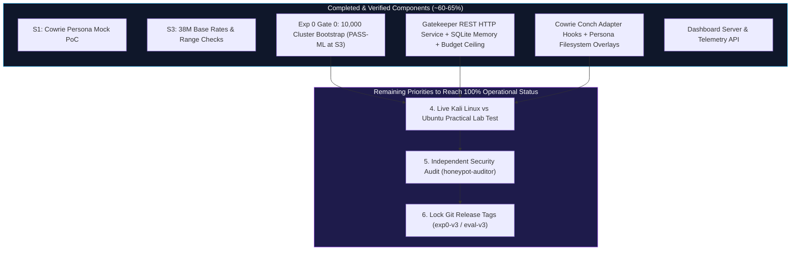

# Schrödinger's Server

**A cost-aware adaptive SSH honeypot: spend expensive deception only where it pays.**

[](https://github.com/abhinavsingh2403/Schrodinger-s-Server/tree/eval-v1)
[](https://github.com/abhinavsingh2403/Schrodinger-s-Server/tree/exp0-v1)
[](LICENSE.rst)
[](https://zenodo.org/records/21260400)
[](https://github.com/cowrie/cowrie/tree/v3.1.6)

---

## 1. Project Overview & Core Thesis

In Internet-facing SSH honeypots, the overwhelming majority of sessions are one-shot automated scans and credential brute-force probes. A published LLM-honeypot deployment recorded **147,752 non-interactive sessions out of 148,850 total (99.26%)**, and only **150 interactive sessions (0.10%)** ([CLAIMS.md](CLAIMS.md) P2). Serving high-interaction deception (rich emulated environments, real sandboxed VMs, or LLM-driven backends) indiscriminately wastes significant compute and financial budget on shallow noise.

> **Central Thesis:** A lightweight, cost-aware **gatekeeper** can infer early in an SSH session (handshake, authentication, or first command) whether the attacker is likely to yield interactive intelligence, escalating high-value visitors to higher-fidelity deception personas while serving cheap default emulation to automated noise—maximizing **intelligence yield per rupee**.

---

## 2. Project Completion Status & Progress Accounting

> **Branch Notice:** Active engineering code, empirical pipelines, and test suites live on branch **[`trainmodel`](https://github.com/abhinavsingh2403/Schrodinger-s-Server/tree/trainmodel)**.

### Evidence-based progress

<!-- GENERATED PROGRESS START -->
| Item | Weight | Status | Evidence / limitation |
|---|---:|---|---|
| S3 aggregate base rates | 2 | Done | results/base_rates.json and analysis/s3_base_rates.py |
| Event-schema check and group field | 2 | Done | results/s3_event_schema.json; event order remains unverified |
| Experiment 0 aggregate stages S1-S3 with leakage controls | 2 | Partial | Stage guards exist; shuffled-label diagnostic fails and event ordering is unverified |
| Experiment 0 event-level S4/S5 | 2 | Not done | NOT_EVALUABLE on aggregate data |
| T1/T2 personas and real Cowrie integration on Linux | 2 | Partial | Configs and unit tests exist; Linux collection fails because lark is absent |
| Real hardware cost measurement (Spike S2) | 2 | Not done | Nominal constants only |
| Gatekeeper trained model and offline/live parity | 1 | Partial | Model loads; parity uses one hand-built fixture, not shared offline/live extraction |
| Escalation budget enforcement | 1 | Partial | Decision counter with warmup and memory exceptions; not a strict session cap |
| Persona-effect natural experiment | 1 | Not done | Pending event-level group data |
| Third-party detector evaluation (EVAL H4) | 1 | Not done | Internal checks are not an independent detector evaluation |
| Replay of real held-out traces | 1 | Not done | SYNTHETIC command templates reconstructed from counters |
| Dashboard using only script-generated numbers | 1 | Partial | Reads result JSON and decision DB but has hard-coded numeric fallbacks |
| Public-sensor shadow run under SAFETY checklist | 1 | Not done | No verified run |
| Final report, slides and viva pack | 1 | Partial | Working reports exist; final reviewed pack is absent |

Weighted completion: **40.0%** (8/20); Done = 1, Partial = 0.5, Not done = 0.
Generated by `python -m analysis.progress_accounting`; status judgements are evidence-based, not performance measurements.
<!-- GENERATED PROGRESS END -->

For detailed evidence, scope weights, and verification status for each item, see [`docs/STATUS.md`](docs/STATUS.md).

| Phase / Component | Scope | Status | Honest Details / Audit Reality |
|---|---|---|---|
| **G1: Repo Skeleton & Pinning** | Core | **DONE** | Python 3.12, DuckDB 2.0.0, Pytest 9.2.0 pinned |
| **G2: Streaming Verifier Tooling** | Core | **DONE** | Chunked MD5 streaming verifier (`verify_download.py`) |
| **S3 Part 1: Aggregate Base Rates** | Core | **DONE** | 38.1M sessions analyzed; value=1 base rate = 3.23% (`results/base_rates.json`) |
| **S3 Part 2: Event Archive Verification** | Core | **DONE** | Range request inspection of 19.4GB `data_all.zip`; confirmed 52 days and `group \in {1, 2, 3, 4}` |
| **S1: Cowrie Persona Switching PoC** | Core | **DONE** | Plan A in-process Conch adapter subclass verified in mock loop (`sensor/spike_s1_poc.py`) |
| **O3: Experiment 0 (`EXPERIMENT0.md`)** | Core (Gate 0) | **PARTIAL: PASS-ML at S3** | ML recall 0.2919; rule recall 0.1151; adjusted CI [0.0052, 0.6125]. Exploratory-confirmatory; shuffle and prefix-validity checks unresolved. See [audit](results/exp0/AUDIT.md). |
| **Phase 1: Gatekeeper Engine & Memory** | MVP | **BUILT & TESTED** | REST HTTP server (`/health`, `/decide`, `/record_session`), `GatekeeperClient`, SQLite WAL visitor memory, upward-only policy with budget ceiling, parity extractor. Automatically loads `models/model_s3.json`; current test outcomes and limitations are in HANDOFF.md. |
| **Phase 1: Sensor & Router Subsystems** | MVP | **LOOPBACK VERIFIED** | `CowrieSSHSessionAdapter` with in-process Conch lifecycle hooks (handshake, auth, PTY, shell/exec, close), dynamic persona switching via hostname and filesystem overlay. Lab-verified on WSL loopback; Docker stack is NOT operational end-to-end. |
| **Phase 2: Adversary Harness & Infra** | MVP | **CODE COMPLETE / LAB-ONLY** | Attacker scenarios (`bot_like`, `interactive`, `transfer_like`) with safe askpass auth and exit-code 255 checking. Unit tests pass; cross-VM network execution (Kali Linux -> WSL) not yet tested. |
| **Phase 2: Cost & Arm Simulation** | MVP | **ORACLE BOUND** | Nominal cost model; Arm D labeled as retrospective hindsight upper bound (`results/arm_simulation.json`). |
| **EVAL 5.3: Persona Natural Experiment** | MVP | **PENDING DATA** | Blocked on event-level `group` ingestion from `data_all.zip` (field absent in `session_aggregation`). |
| **Phase 2: Results Dashboard** | MVP | **PARTIAL** | Cyber Protocol theme, privacy masking (`vis_xxxx`), zero npm dependencies. Reads SQLite `decision_log` and displays `NO DATA` when empty; continuous live-traffic stream not yet demonstrated. |
| **Phase 3: Live VPS Trial / T3 VM Pool** | Post-MVP | **DEFERRED** | Dependent on Linux testbed with Twisted Conch runtime and live honeypot exposure. |

---

## 3. Data Provenance & Ground Truth

All empirical analysis is performed on open-access, peer-reviewed research data.

### Primary Dataset: D1 (Zenodo Record 21260400)
- **Title**: Large-Scale Empirical Dataset of 38 Million SSH Honeypot Sessions
- **Source URL**: `https://zenodo.org/records/21260400`
- **License**: Creative Commons Attribution 4.0 International (CC-BY 4.0)
- **Direct Download URL**: `https://zenodo.org/api/records/21260400/files/session_aggregation.jsonl.gz/content`
- **File Name**: `data/session_aggregation.jsonl.gz` (Gitignored per security rules)
- **File Size**: `1,328,104,319 bytes` (~1.33 GB compressed)
- **Expected MD5**: `1f3897650fb420c97c14ff452398c3f8`
- **Computed MD5**: `1f3897650fb420c97c14ff452398c3f8` (**MATCH**, verified via `analysis/verify_download.py`)

### Dataset Ground Truth Findings ([results/base_rates.json](results/base_rates.json))
Computed over the complete dataset using DuckDB with zero dropped sessions:
- **Total Sessions Analyzed**: `38,126,048`
- **Temporal Span**: `52 continuous calendar days` (2025-06-27 to 2025-08-17 UTC)
- **Schema Conformity**: Exact match on all **25 schema fields** listed in `DATA.md`
- **Login Success Count**: `4,374,446` (11.47% authentication pass rate)
- **Command Input Sessions**: `3,335,870` (8.75%)
  - Zero commands (pure probe): `34,790,178` (91.25%)
  - 1–4 commands: `2,185,616` (5.73%)
  - 5–9 commands: `992,305` (2.60%)
  - 10+ commands: `157,949` (0.41%)
  - Command Quantiles: **p50 = 0, p90 = 0, p99 = 2**
- **File Transfers**: `755,225` sessions (1.98%)
- **Direct-TCPIP Requests (Pivoting)**: `467,551` sessions (1.23%)
- **Aggregate Value=1 Base Rate (`N_CMD >= 5 OR file transfer OR pivot`)**: **3.23% (1,232,570 sessions)**
  - Confirms a realistic, non-degenerate class imbalance well-suited for early stage triage and PR-AUC evaluation.

---

## 4. Key Engineering Milestones Completed

### 1. Pinned Cowrie Upstream Audit (Tag `v3.1.6`)
- Pinned commit hash: `ea9513eda9ea0dac05f6ace7db84ca95e0571501`
- Read-only audit copy stored in `sensor/cowrie-src/`
- Full code path traceability verified with line-number citations across:
  - SSH Transport & Banner: `src/cowrie/ssh/transport.py:72`, `src/cowrie/ssh/factory.py:107`
  - Key Exchange & HASSH: `src/cowrie/ssh/transport.py:258-281`
  - User Authentication: `src/cowrie/ssh/userauth.py:134`, `src/cowrie/shell/realm.py:22`
  - Shell & Fake Filesystem: `src/cowrie/shell/session.py:48`, `src/cowrie/shell/fs.py:126`, `src/cowrie/core/honeyfs.py:65`
  - Command Dispatch: `src/cowrie/shell/honeypot.py:932`, `src/cowrie/shell/protocol.py:246`
  - Proxy/Pool Backend Selection: `src/twisted/plugins/cowrie_plugin.py:162`

### 2. Spike S1 Outcome: Plan A (In-Process Hook) Verified
- **Question**: Can Cowrie choose the persona per session after login without a deep fork?
- **Finding**: **YES.** Subclassing Twisted Conch's session adapter (`cowrie.shell.session.SSHSessionForCowrieUser`) allows dynamic persona assignment (hostname, custom filesystem overlay) with **0 lines changed in Cowrie core**. Merge-pain risk on upstream updates is near zero.
- **Proof-of-Concept**: [`sensor/spike_s1_poc.py`](sensor/spike_s1_poc.py) verified:
  - Session A (odd client port) assigned Persona 1 (`web-srv-01`, Ubuntu 22.04 T2 persona).
  - Session B (even client port) assigned Persona 2 (`generic-srv-02`, Debian 12 T1 persona).
  - Automated test suite: [`sensor/test_spike_s1_poc.py`](sensor/test_spike_s1_poc.py) passing (`2 passed`).

### 3. Pre-Registration Enforced
- Git tags applied to lock experimental hypotheses prior to model training:
  - `eval-v1`: Locks evaluation metrics, success criteria, and label definitions.
  - `exp0-v1`: Locks Experiment 0 protocol per `EXPERIMENT0.md`.

---

## 5. Prioritized Engineering & Scientific Action Plan



### Technical Audit Findings & Remediation Roadmap

Based on rigorous peer audit, the remediation items are tracked as follows:

1. **Bootstrap Procedure Correction (Priority 1) — COMPLETED**:
   * *Audit Finding*: Previous bootstrap computed threshold globally on test data and resampled only positive-containing clusters across 1,000 resamples.
   * *Action Completed*: Bootstrap includes all stage-specific source clusters and recalculates the budget per draw. This audit also fixes process-dependent cluster ordering; see generated concentration and sensitivity diagnostics.
   * *Outcome*: Regenerated S3 ML recall 0.2919 vs rule 0.1151, delta 0.1768, adjusted CI [0.0052, 0.6125]. The numerical outcome remains PASS-ML; the transfer-driven gain and failed shuffle/prefix checks limit interpretation.

2. **Gatekeeper REST Service & Decision Engine (Priority 2) — COMPLETED**:
   * *Audit Finding*: The Gatekeeper lacked an HTTP service and CLI startup, meaning separate containers could not communicate.
   * *Action Completed*: Implemented `GatekeeperHTTPHandler`, `GatekeeperServer`, and `GatekeeperClient` in `gatekeeper/decision_api.py` with endpoints `/health`, `/decide`, and `/record_session`. Configured `python -m gatekeeper.decision_api --host 0.0.0.0 --port 5000` in Docker Compose with health check. Unit tested with ephemeral live HTTP server.

3. **Cowrie In-Process Conch Lifecycle Hooks (Priority 3) — COMPLETED**:
   * *Audit Finding*: Cowrie container was not forwarding transport or session events to custom adapter classes, and persona filesystem overlays were not dynamically updated upon tier escalation.
   * *Action Completed*: Subclassed Twisted Conch's `SSHSessionForCowrieUser` in `sensor/adaptive_server.py`, wiring `on_kex_completed`, `on_auth_completed`, `getPty` (terminal allocation), `openShell`/`execCommand`, and `closed` (session closing and visitor memory recording). Implemented `_on_tier_escalated` updating `self.server.hostname`, applying filesystem overlay, and updating `avatar.environ["HOSTNAME"]`. Bound Cowrie SSH listener to `0.0.0.0:2222`.

### 4. Live Demonstration Readiness & Technical Reality (November 24 Milestone)

Direct inspection of `infra/docker-compose.yml`, `sensor/run_sensor.py`, `dashboard/app.py`, and `results/exp0/live_*_proof.json` establishes the current subsystem reality:

| Subsystem | State | Verifiable Reality & Current Boundaries |
|---|---|---|
| **Kali Adversary Scripts** (`bot_like`, `interactive`, `transfer_like`) | **Code Complete & Tested** | Implemented in `harness/attackers/` with `SSH_ASKPASS` / `sshpass` credential handling without command-line argument leakage, OpenSSH returncode 255 checking, and single-line JSON summaries. Unit tests pass. **Live execution from an external Kali VM across host boundaries into Cowrie has not yet been executed.** |
| **Cowrie ↔ Gatekeeper Inter-Process Communication** | **Lab-Verified on WSL Loopback** | Real Twisted Conch lifecycle hooks (`sensor/run_sensor.py`) communicate with `GatekeeperServer` over loopback HTTP (`http://127.0.0.1:5000`) and apply in-process T2 filesystem overlays (`results/exp0/live_switch_proof.json`, `results/exp0/live_sensor_proof.json`). **Network reachability from an external Kali VM host into the WSL guest is untested.** |
| **Cowrie Event Telemetry** | **Verified in WSL** | Structured JSON logs (`var/log/cowrie/cowrie.json`) record real session events and can be monitored live via terminal `tail -f`. |
| **Docker Compose Stack** | **NOT Operational End-to-End** | **Direct inspection reveals four concrete issues blocking end-to-end container execution:**<br/>1. **Stock Image vs Custom Launcher**: `infra/docker-compose.yml` runs stock `cowrie/cowrie:v3.1.6`, which launches vanilla Cowrie in isolation and never invokes `sensor.run_sensor` or Gatekeeper.<br/>2. **Loopback Gatekeeper Enforcement**: `sensor/run_sensor.py:88-89` checks `urlparse(args.gatekeeper_url).hostname != '127.0.0.1'` and aborts via `parser.error()`. In Docker, the container address is `http://gatekeeper:5000`, which immediately aborts launcher startup.<br/>3. **Gatekeeper Volume Mounts & Silent ML Disablement**: `../analysis` is unmounted in Gatekeeper, causing an immediate `ImportError` on `PurePythonLogisticRegression`. Furthermore, `../models` is unmounted; `gatekeeper/decision_api.py:107` catches missing model files and silently sets `self.model = None`, falling back to heuristic rules without failing or logging an error. A strict startup model validation check is required.<br/>4. **Network Egress / Routing Uncertainty**: `internal_honeypot_net` is declared `internal: true` while publishing port `2222`. Docker internal bridges omit default gateways; bidirectional TCP routing back to the host interface remains an unverified hypothesis on Linux. *(Note: Gatekeeper itself requires zero third-party pip packages; policy, decision logic, and inference fallbacks run on pure Python standard library).* |
| **Telemetry Dashboard** | **Static / File-Based Only** | `dashboard/app.py` reads `decision_log` from SQLite and falls back to `NO DATA` badges. **It has never been demonstrated with continuous live honeypot traffic.** |
| **Policy Escalation Behavior** | **Conservative Default (T1 Only)** | Under the default pre-registered policy, sessions do not escalate to T2 because strict budget ceilings and default heuristic thresholds require high-activity indicators. For live demonstration, a controlled lab policy or explicit escalation trigger (Option 3) is required to exhibit T2 files. |

#### Demonstration Deployment Strategy

1. **Path A (Primary / Low-Risk Strategy for Nov 24 Demonstration — Native WSL)**:
   Run all components natively inside WSL (where dependencies and loopback IPC are verified):
   - **Terminal 1**: `python -m gatekeeper.decision_api --host 127.0.0.1 --port 5000 --db gatekeeper/gatekeeper.db`
   - **Terminal 2**: `python -m sensor.run_sensor --state-dir var/cowrie --port 2222 --gatekeeper-url http://127.0.0.1:5000`
   - **Terminal 3**: `python dashboard/app.py`
   - **Terminal 4 / Kali VM**: Execute `harness/demo/run_lab_demo.sh` or individual adversary scripts against port `2222`.
   - **Terminal 5 (Evidence)**: `tail -f var/cowrie/log/cowrie.json`.
   - *Current Remaining Scope for Path A*: Testing external network reachability from the Kali VM to WSL port 2222, configuring the Option 3 demo escalation profile (so decoys visibly appear during the presentation), verifying dashboard live updates, and dry-run rehearsals.

2. **Path B (Full Docker Containerization — Dual-Track Stretch Goal)**:
   - Install Docker Desktop and verify the daemon via `docker run --rm hello-world`.
   - Containerizing the full stack requires authoring a custom Dockerfile for the sensor extending `cowrie/cowrie:v3.1.6`, passing Gatekeeper DNS allowance flags to `run_sensor.py`, mounting `analysis/` and `models/`, adding an explicit startup model-validation check, and validating `internal: true` bridge routing.
   - *Schedule*: Keep both paths open. If Docker end-to-end integration passes verification by Tue Nov 17, it can be demonstrated; otherwise, Path A (native WSL) is the reliable fallback.

---

## 6. Architecture

```
                         Internet (attackers, scanners, bots)
                                      |
                              [ VPS Firewall ]
                                      |
                     +----------------+-----------------+
                     |     Twisted Conch Router         |   Plan A: In-process hook
                     | (AdaptiveSSHSession Adapter)     |   (Verified in Spike S1)
                     +--------+---------------+---------+
                              |               |
                      +-------+--+     +------+-----+      +-----------------+
                      | T1 Lite  |     | T2 Hardened|      | T3 Real VM      |
                      | Cowrie   |     | Cowrie     |      | Cowrie proxy -> |
                      | shell    |     | shell+fs   |      | sandboxed guest |
                      +-------+--+     +------+-----+      +--------+--------+
                              \               |                     /
                               +---- Cowrie JSON Event Logs -------+
                                              |
                                   +----------v----------+
                                   |     Gatekeeper      |
                                   | stage features,     |
                                   | Model V, policy,    |
                                   | visitor memory      |
                                   +----------+----------+
                                              |
                           +------------------+-------------------+
                           |                                      |
                   Decision Log (SQLite)                 Dashboard (read-only)
```

---

## 7. Repository Layout

```
Schrodinger-s-Server/
├── README.md               # Project overview, status, data provenance, roadmap
├── SPEC.md                 # System specification: architecture, components, models
├── EVAL.md                 # Pre-registered evaluation plan (Tag: eval-v1)
├── DATA.md                 # Dataset specifications, schema definitions, hashes
├── SPIKES.md               # Go/no-go technical spike specifications
├── SPIKE_RESULTS.md        # Recorded outcomes of completed spikes (S1, S3)
├── EXPERIMENT0.md          # Gate 0 Experiment specification (Tag: exp0-v1)
├── WEEK1.md                # Day-by-day execution plan and gating criteria
├── SAFETY.md               # Legal, ethical, and operational safety rules
├── AGENTS.md               # System and agent coding standards
├── CLAIMS.md               # Ledger of verified external claims ([V]/[S]/[U])
├── DECISIONS.md            # Architecture Decision Records (ADRs)
├── HANDOFF.md              # Cross-agent state and progress ledger
├── requirements.txt        # Pinned dependencies (duckdb==2.0.0, pytest==9.2.0)
├── analysis/               # Offline data pipelines and verification scripts
│   ├── s3_base_rates.py    # 38M session DuckDB base rate pipeline
│   ├── test_s3_base_rates.py # Unit tests for base rate logic and schema checks
│   ├── verify_download.py  # Streaming chunked MD5 file verification tool
│   └── test_verify_download.py # Pytest test suite for verifier
├── sensor/                 # Honeypot sensor components and study copy
│   ├── cowrie-src/         # Pinned Cowrie v3.1.6 source tree (gitignored)
│   ├── spike_s1_poc.py     # Spike S1 in-process persona switching proof-of-concept
│   └── test_spike_s1_poc.py # Unit test suite for S1 PoC
├── data/                   # Dataset store (gitignored)
│   └── README.md           # Download ledger with verified checksums
├── results/                # Script-generated outputs (never hand-edited)
│   ├── base_rates.json     # Empirical base rates from 38,126,048 sessions
│   └── MANIFEST.json       # Run manifest: hashes, versions, commit IDs, timestamps
├── infra/                  # Infrastructure scripts and firewall definitions
├── gatekeeper/             # Feature extractor, Model V, and visitor memory
├── router/                 # In-process escalation hooks
├── harness/                # Lab test harness and adversary runners
└── dashboard/              # Read-only offline visualization dashboard
```

---

## 8. Reproducibility & Running Tests

### Environment Setup
Python 3.12+ with virtual environment:
```powershell
python -m venv .venv
.\.venv\Scripts\pip install -r requirements.txt
```

### Run Unit Tests
```powershell
.\.venv\Scripts\python -m pytest -q
```

### Live Honeypot Demonstration (Native WSL — Path A)
To run the live honeypot integration demonstrator natively in WSL:
```bash
# Terminal 1: Decision Gatekeeper
python -m gatekeeper.decision_api --host 127.0.0.1 --port 5000 --db gatekeeper/gatekeeper.db

# Terminal 2: Cowrie Adaptive Sensor Launcher
python -m sensor.run_sensor --state-dir var/cowrie --port 2222 --gatekeeper-url http://127.0.0.1:5000

# Terminal 3: Telemetry Dashboard
python dashboard/app.py

# Terminal 4: Adversary Attack Execution (from Kali Linux or local shell)
bash harness/demo/run_lab_demo.sh
```

### Containerization Status (Docker Compose)
Running `docker compose up` currently starts isolated containers, but containerized end-to-end integration is not operational:
1. `sensor` runs stock `cowrie/cowrie:v3.1.6` instead of launching `sensor.run_sensor`.
2. `sensor.run_sensor` validates `urlparse(args.gatekeeper_url).hostname != '127.0.0.1'`, aborting via `parser.error` on Docker's service name `http://gatekeeper:5000`.
3. Gatekeeper volume mounts omit `../analysis` (causing `ImportError`) and `../models` (causing silent fallback to `self.model = None` where ML deactivates without a startup error).
4. `internal_honeypot_net` (`internal: true`) requires physical verification for inbound port `2222` return routing.
*(Gatekeeper requires no third-party pip dependencies, running on standard library and pure-Python modules).*
Use **Path A (native WSL)** as the primary verified path while Docker containerization is developed.

### Reproduce Spike S1 Persona Switching PoC
```bash
python sensor/spike_s1_poc.py
python -m pytest sensor/test_spike_s1_poc.py
```

### Run Base Rates on 38 Million Sessions
```powershell
.\.venv\Scripts\python analysis/s3_base_rates.py --file data/session_aggregation.jsonl.gz --n-cmd 5
```

---

## 9. Non-Negotiable Safety & Ethics Rules
Per [`SAFETY.md`](SAFETY.md):
1. **Offline Phase 0**: All early work uses public datasets and lab mock loops. No network-facing exposure.
2. **Zero Fabrication**: Every reported metric and table value originates from a script. Never typed by hand.
3. **No Attacks**: No scanning, probing, or counter-exploitation of third-party systems.
4. **Data Protection**: Raw attacker IPs are never committed. Analysis uses salted HMAC IDs.
5. **Malware Safety**: Captured files are never executed. `transferred_files.zip` is strictly banned from download.

---

## 10. References & Literature Cited

All external datasets, academic papers, and security frameworks are tracked with their verification statuses in [`CLAIMS.md`](CLAIMS.md).

### Datasets & Data Descriptors
- **[D1] Large-Scale Empirical Dataset of 38 Million SSH Honeypot Sessions** (2025/2026). Zenodo Record 21260400. DOI: [`10.5281/zenodo.21260400`](https://zenodo.org/records/21260400). Licensed under CC BY 4.0.
  - Data Descriptor in press: *Nature Scientific Data* (2026), DOI: [`10.1038/s41597-026-08668-0`](https://doi.org/10.1038/s41597-026-08668-0).
- **[D2] Honey for the Agent Dataset** (2026). Multi-environment LLM attacker traces on five SSH targets. Zenodo Record 20818246. DOI: [`10.5281/zenodo.20818246`](https://zenodo.org/records/20818246). Licensed under CC BY 4.0.
- **[D3] Beyond Bots Dataset** (2026). Empirical SSH probe traces with heuristic indicators. Zenodo Record 19610238. DOI: [`10.5281/zenodo.19610238`](https://zenodo.org/records/19610238).

### Academic Papers & Preprints
- **[P1] Explainability-Driven Adaptive Deception Control System on Cowrie** (2026). Proposes random-forest behavioral profiling with epsilon-greedy Q-learning strategy selection. *Scientific Reports* (Nature Portfolio). DOI: [`10.1038/s41598-026-64427-6`](https://www.nature.com/articles/s41598-026-64427-6).
- **[P2] Multi-Agent LLM SSH Honeypot Deployment** (2026). Empirical measurement of 148,850 honeypot sessions showing a 99.26% non-interactive automation rate. arXiv:2606.27990. [`https://arxiv.org/abs/2606.27990`](https://arxiv.org/abs/2606.27990).
- **[P3] Palisade: LLM Agent Honeypot with Prompt-Injection and Timing Analysis** (2024). Active and passive behavioral fingerprinting of autonomous agents over 8M attempts. arXiv:2410.13919. [`https://arxiv.org/abs/2410.13919`](https://arxiv.org/abs/2410.13919).
- **[P4] Honey for the Agent: Behavioral Differences Across Environments & Early Attacker Fingerprinting** (Sept 2026). Evaluates cross-environment model identification and early session fingerprinting. *ResearchGate Publication*.
- **[P5] Rouxii: AI Pentesters That Detect and Exploit Honeypots** (2026). Analysis of honeypot fingerprinting surfaces, single-packet identification across 7,605 instances, and Cowrie attack surface auditing. arXiv:2609.26555. [`https://arxiv.org/abs/2609.26555`](https://arxiv.org/abs/2609.26555).
- **[P6] LLM-Based Penetration Testing in the Presence of Honeypots** (2026). Budget-aware ranking, pre-connect screening, and stopping rules for autonomous attack agents. arXiv:2609.08093. [`https://arxiv.org/abs/2609.08093`](https://arxiv.org/abs/2609.08093).
- **[P7] Local-LLM SSH Honeypots and Automated Evaluation Benchmarking** (2026). Architectural survey of local LLM honeypot backends and proxy emulation. arXiv:2608.18686. [`https://arxiv.org/abs/2608.18686`](https://arxiv.org/abs/2608.18686).
- **[P8] A Measurement Study of Attackers on Medium-Interaction Honeypots and HASSH Limitations** (2022). Evaluation of 2.6M successful logins demonstrating that HASSH fingerprints are too broad for granular attacker correlation. arXiv:2206.13614. [`https://arxiv.org/abs/2206.13614`](https://arxiv.org/abs/2206.13614).
- **[P9] Classification of Human, Automated, and AI-Assisted SSH Attackers from Session Features** (2024). Session feature engineering and classification under severe class imbalance (6,231:1). Rochester Institute of Technology (RIT) Master's Thesis. [`https://repository.rit.edu/theses/12605/`](https://repository.rit.edu/theses/12605/).
- **[P10] Improvement of Cowrie Honeypot Interaction and Deception Capabilities** (2025). Survey on honeypot fingerprinting mitigation, filesystem persistence, and interaction depth. *ResearchGate Survey*.
- **[P11] Inter-Command Gap Analysis in SSH Honeypot Bot Detection** (2024). Heuristic scoring of human vs bot interaction using command arrival intervals. [`https://github.com/Mukundmishra13/ssh-honeypot`](https://github.com/Mukundmishra13/ssh-honeypot).

### Security Tools, Frameworks & Standards
- **[T1–T4] Cowrie SSH/Telnet Honeypot** (Michel Oosterhof, Upi Tamminen). Medium-to-high interaction honeypot engine. Pinned at release `v3.1.6` (`ea9513eda9ea0dac05f6ace7db84ca95e0571501`). Licensed under BSD-3-Clause. [`https://github.com/cowrie/cowrie`](https://github.com/cowrie/cowrie) / [`https://docs.cowrie.org`](https://docs.cowrie.org).
- **[T5] honeypot-auditor**: Automated honeypot detection tool evaluating shell semantics, OS coherence, HASSH, and TCP latency. Licensed under MIT. [`https://pypi.org/project/honeypot-auditor/`](https://pypi.org/project/honeypot-auditor/).
- **[T6] ARACNE**: Autonomous LLM-driven SSH penetration testing agent supporting local Ollama models. Stratosphere Laboratory (GPL-2.0). [`https://github.com/stratosphereips/aracne`](https://github.com/stratosphereips/aracne).
- **[T7] PentestGPT**: LLM-empowered penetration testing framework for automated security assessment. Licensed under MIT. [`https://github.com/GreyDGL/PentestGPT`](https://github.com/GreyDGL/PentestGPT).
- **[T8] HASSH**: Cryptographic SSH client and server fingerprinting standard based on key exchange algorithm negotiation. Salesforce / Corelight. [`https://github.com/salesforce/hassh`](https://github.com/salesforce/hassh).
- **[T9] Fake Honeypots: Deception Through Apparent Vulnerability** (Rowe et al.). Naval Postgraduate School. [`https://faculty.nps.edu/ncrowe/fakehoney.htm`](https://faculty.nps.edu/ncrowe/fakehoney.htm).
