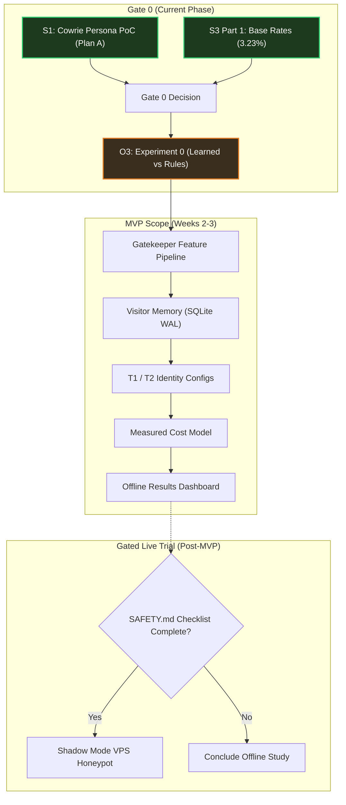

# Schrödinger's Server

**A cost-aware adaptive SSH honeypot: spend expensive deception only where it pays.**

[](https://github.com/abhinavsingh2403/Schrodinger-s-Server/tree/eval-v1)
[](https://github.com/abhinavsingh2403/Schrodinger-s-Server/tree/exp0-v1)
[](LICENSE.rst)
[](https://zenodo.org/records/21260400)
[](https://github.com/cowrie/cowrie/tree/v3.1.6)

---

## 1. Project Overview & Core Thesis

In Internet-facing SSH honeypots, the overwhelming majority of sessions are one-shot automated scans and credential brute-force probes. A published LLM-honeypot deployment recorded **147,752 non-interactive sessions out of 148,850 total (99.26%)**, and only **150 interactive sessions (0.10%)** ([CLAIMS.md](file:///c:/Users/abhip/OneDrive/Documents/mini%20project/CLAIMS.md) P2). Serving high-interaction deception (rich emulated environments, real sandboxed VMs, or LLM-driven backends) indiscriminately wastes significant compute and financial budget on shallow noise.

> **Central Thesis:** A lightweight, cost-aware **gatekeeper** can infer early in an SSH session (handshake, authentication, or first command) whether the attacker is likely to yield interactive intelligence, escalating high-value visitors to higher-fidelity deception personas while serving cheap default emulation to automated noise—maximizing **intelligence yield per rupee**.

---

## 2. Project Completion Status: ~42% (MVP) / ~26% (Full Scope)

The project follows a strict phased gating model ([SPEC.md §0](file:///c:/Users/abhip/OneDrive/Documents/mini%20project/SPEC.md#L8-L18), [WEEK1.md](file:///c:/Users/abhip/OneDrive/Documents/mini%20project/WEEK1.md)). Below is the exact progress breakdown:

```
[██████████████████████░░░░░░░░░░░░░░░░░░░░░░░░░░░░░░] 42% MVP Complete
[█████████████░░░░░░░░░░░░░░░░░░░░░░░░░░░░░░░░░░░░░░░] 26% Full Scope Complete
```

| Phase / Component | Scope | Status | Weight | % Done |
|---|---|---|:---:|:---:|
| **G1: Repo Skeleton & Pinning** | Core | **DONE** (`ae7b342`) | 5% | 100% |
| **G2: Streaming Verifier & Tooling** | Core | **DONE** (`2685e45`) | 5% | 100% |
| **G3 / S3 Part 1: Data Reality Check & Base Rates** | Core | **DONE** (`3c92d32`, `90eaacc`) | 12% | 100% |
| **O1: Read-Only Audit of Base Rates** | Core | **DONE** (`b019e71`) | 5% | 100% |
| **O2 / S1: Cowrie Persona Switching Investigation & PoC** | Core | **DONE** (`bae4e27`) | 15% | 100% |
| **Pre-Registration Tags (`eval-v1`, `exp0-v1`)** | Core | **DONE** (Applied & Pushed) | 3% | 100% |
| **O3: Experiment 0 Implementation (`EXPERIMENT0.md`)** | Core (Gate 0) | *In Progress (Next)* | 20% | 0% |
| **S3 Part 2: Event-level verification (2-3 days)** | Core (Gate 0) | *Pending O3* | 5% | 0% |
| **Phase 1: Gatekeeper Engine & SQLite Memory** | MVP | *Planned* | 12% | 0% |
| **Phase 1: Persona Configuration (T1 vs T2)** | MVP | *Planned* | 6% | 0% |
| **Phase 2: Cost Model & Dashboard (`dashboard/`)** | MVP | *Planned* | 12% | 0% |
| **Phase 2: Lab Adversary Harness (honeypot-auditor)** | Full Scope | *Gated* | - | 0% |
| **Phase 3: Live VPS Trial (Shadow Mode)** | Full Scope | *Gated* | - | 0% |
| **Phase 3: T3 Real-VM Pool Tier** | Deferred | *Deferred* | - | 0% |

- **Phase 0 (Foundation & Gate 0 Spikes):** **~65% Complete**
- **MVP Scope (Offline Study, Exp 0, T1/T2 Persona, Cost Model, Dashboard):** **~42% Complete**
- **Full Life-Cycle Scope (including live VPS sensor, RCT, and deferred tiers):** **~26% Complete**

---

## 3. Data Provenance & Ground Truth

All empirical analysis is performed on open-access, peer-reviewed research data.

### Primary Dataset: D1 (Zenodo Record 21260400)
- **Title**: Large-Scale Empirical Dataset of 38 Million SSH Honeypot Sessions
- **Source URL**: `https://zenodo.org/records/21260400`
- **License**: Creative Commons Attribution 4.0 International (CC-BY 4.0)
- **Direct Download URL**: `https://zenodo.org/api/records/21260400/files/session_aggregation.jsonl.gz/content`
- **File Name**: `data/session_aggregation.jsonl.gz` (Gitignored per security rules)
- **File Size**: `1,328,104,319 bytes` (~1.33 GB compressed)
- **Expected MD5**: `1f3897650fb420c97c14ff452398c3f8`
- **Computed MD5**: `1f3897650fb420c97c14ff452398c3f8` (**MATCH**, verified via `analysis/verify_download.py`)

### Dataset Ground Truth Findings ([results/base_rates.json](file:///c:/Users/abhip/OneDrive/Documents/mini%20project/results/base_rates.json))
Computed over the complete dataset using DuckDB with zero dropped sessions:
- **Total Sessions Analyzed**: `38,126,048`
- **Temporal Span**: `52 continuous calendar days` (2025-06-27 to 2025-08-17 UTC)
- **Schema Conformity**: Exact match on all **25 schema fields** listed in `DATA.md`
- **Login Success Count**: `4,374,446` (11.47% authentication pass rate)
- **Command Input Sessions**: `3,335,870` (8.75%)
  - Zero commands (pure probe): `34,790,178` (91.25%)
  - 1–4 commands: `2,185,616` (5.73%)
  - 5–9 commands: `992,305` (2.60%)
  - 10+ commands: `157,949` (0.41%)
  - Command Quantiles: **p50 = 0, p90 = 0, p99 = 2**
- **File Transfers**: `755,225` sessions (1.98%)
- **Direct-TCPIP Requests (Pivoting)**: `467,551` sessions (1.23%)
- **Aggregate Value=1 Base Rate (`N_CMD >= 5 OR file transfer OR pivot`)**: **3.23% (1,232,570 sessions)**
  - Confirms a realistic, non-degenerate class imbalance well-suited for early stage triage and PR-AUC evaluation.

---

## 4. Key Engineering Milestones Completed

### 1. Pinned Cowrie Upstream Audit (Tag `v3.1.6`)
- Pinned commit hash: `ea9513eda9ea0dac05f6ace7db84ca95e0571501`
- Read-only audit copy stored in `sensor/cowrie-src/`
- Full code path traceability verified with line-number citations across:
  - SSH Transport & Banner: `src/cowrie/ssh/transport.py:72`, `src/cowrie/ssh/factory.py:107`
  - Key Exchange & HASSH: `src/cowrie/ssh/transport.py:258-281`
  - User Authentication: `src/cowrie/ssh/userauth.py:134`, `src/cowrie/shell/realm.py:22`
  - Shell & Fake Filesystem: `src/cowrie/shell/session.py:48`, `src/cowrie/shell/fs.py:126`, `src/cowrie/core/honeyfs.py:65`
  - Command Dispatch: `src/cowrie/shell/honeypot.py:932`, `src/cowrie/shell/protocol.py:246`
  - Proxy/Pool Backend Selection: `src/twisted/plugins/cowrie_plugin.py:162`

### 2. Spike S1 Outcome: Plan A (In-Process Hook) Verified
- **Question**: Can Cowrie choose the persona per session after login without a deep fork?
- **Finding**: **YES.** Subclassing Twisted Conch's session adapter (`cowrie.shell.session.SSHSessionForCowrieUser`) allows dynamic persona assignment (hostname, custom filesystem overlay) with **0 lines changed in Cowrie core**. Merge-pain risk on upstream updates is near zero.
- **Proof-of-Concept**: [`sensor/spike_s1_poc.py`](file:///c:/Users/abhip/OneDrive/Documents/mini%20project/sensor/spike_s1_poc.py) verified:
  - Session A (odd client port) assigned Persona 1 (`web-srv-01`, Ubuntu 22.04 T2 persona).
  - Session B (even client port) assigned Persona 2 (`generic-srv-02`, Debian 12 T1 persona).
  - Automated test suite: [`sensor/test_spike_s1_poc.py`](file:///c:/Users/abhip/OneDrive/Documents/mini%20project/sensor/test_spike_s1_poc.py) passing (`2 passed`).

### 3. Pre-Registration Enforced
- Git tags applied to lock experimental hypotheses prior to model training:
  - `eval-v1`: Locks evaluation metrics, success criteria, and label definitions.
  - `exp0-v1`: Locks Experiment 0 protocol per `EXPERIMENT0.md`.

---

## 5. What Remains To Be Done



### Next Immediate Task: **Task O3 (Experiment 0)**
1. **Label Construction**: Code `V_full` (≥5 distinct commands, file transfer, or direct-tcpip) with unit tests.
2. **Split Construction**: Temporal split + Source-IP group split with temporal and group leakage assertions.
3. **Rule Baselines (R0 to R7)**: Implement rule heuristics (known usernames, HASSH clusters, default passwords).
4. **Learned Models**: Fit Logistic Regression and LightGBM / GBDT models exclusively on training data.
5. **Cluster Bootstrap**: Measure recall of `V_full` at 10% budget and evaluate Section 12 decision rule (`PASS-ML`, `PASS-LATE-ONLY`, or `FAIL`).
6. **Report**: Output results directly via script into `EXP0_RESULT.md`.

---

## 6. Architecture

```
                         Internet (attackers, scanners, bots)
                                      |
                              [ VPS Firewall ]
                                      |
                     +----------------+-----------------+
                     |     Twisted Conch Router         |   Plan A: In-process hook
                     | (AdaptiveSSHSession Adapter)     |   (Verified in Spike S1)
                     +--------+---------------+---------+
                              |               |
                      +-------+--+     +------+-----+      +-----------------+
                      | T1 Lite  |     | T2 Hardened|      | T3 Real VM      |
                      | Cowrie   |     | Cowrie     |      | Cowrie proxy -> |
                      | shell    |     | shell+fs   |      | sandboxed guest |
                      +-------+--+     +------+-----+      +--------+--------+
                              \               |                     /
                               +---- Cowrie JSON Event Logs -------+
                                              |
                                   +----------v----------+
                                   |     Gatekeeper      |
                                   | stage features,     |
                                   | Model V, policy,    |
                                   | visitor memory      |
                                   +----------+----------+
                                              |
                           +------------------+-------------------+
                           |                                      |
                   Decision Log (SQLite)                 Dashboard (read-only)
```

---

## 7. Repository Layout

```
Schrodinger-s-Server/
├── README.md               # Project overview, status, data provenance, roadmap
├── SPEC.md                 # System specification: architecture, components, models
├── EVAL.md                 # Pre-registered evaluation plan (Tag: eval-v1)
├── DATA.md                 # Dataset specifications, schema definitions, hashes
├── SPIKES.md               # Go/no-go technical spike specifications
├── SPIKE_RESULTS.md        # Recorded outcomes of completed spikes (S1, S3)
├── EXPERIMENT0.md          # Gate 0 Experiment specification (Tag: exp0-v1)
├── WEEK1.md                # Day-by-day execution plan and gating criteria
├── SAFETY.md               # Legal, ethical, and operational safety rules
├── AGENTS.md               # System and agent coding standards
├── CLAIMS.md               # Ledger of verified external claims ([V]/[S]/[U])
├── DECISIONS.md            # Architecture Decision Records (ADRs)
├── HANDOFF.md              # Cross-agent state and progress ledger
├── requirements.txt        # Pinned dependencies (duckdb==2.0.0, pytest==9.2.0)
├── analysis/               # Offline data pipelines and verification scripts
│   ├── s3_base_rates.py    # 38M session DuckDB base rate pipeline
│   ├── test_s3_base_rates.py # Unit tests for base rate logic and schema checks
│   ├── verify_download.py  # Streaming chunked MD5 file verification tool
│   └── test_verify_download.py # Pytest test suite for verifier
├── sensor/                 # Honeypot sensor components and study copy
│   ├── cowrie-src/         # Pinned Cowrie v3.1.6 source tree (gitignored)
│   ├── spike_s1_poc.py     # Spike S1 in-process persona switching proof-of-concept
│   └── test_spike_s1_poc.py # Unit test suite for S1 PoC
├── data/                   # Dataset store (gitignored)
│   └── README.md           # Download ledger with verified checksums
├── results/                # Script-generated outputs (never hand-edited)
│   ├── base_rates.json     # Empirical base rates from 38,126,048 sessions
│   └── MANIFEST.json       # Run manifest: hashes, versions, commit IDs, timestamps
├── infra/                  # Infrastructure scripts and firewall definitions
├── gatekeeper/             # Feature extractor, Model V, and visitor memory
├── router/                 # In-process escalation hooks
├── harness/                # Lab test harness and adversary runners
└── dashboard/              # Read-only offline visualization dashboard
```

---

## 8. Reproducibility & Running Tests

### Environment Setup
Python 3.12+ with virtual environment:
```powershell
python -m venv .venv
.\.venv\Scripts\pip install -r requirements.txt
```

### Run Unit Tests
```powershell
.\.venv\Scripts\python -m pytest analysis/
```

### Reproduce Spike S1 Persona Switching PoC
```bash
python sensor/spike_s1_poc.py
python -m pytest sensor/test_spike_s1_poc.py
```

### Run Base Rates on 38 Million Sessions
```powershell
.\.venv\Scripts\python analysis/s3_base_rates.py --file data/session_aggregation.jsonl.gz --n-cmd 5
```

---

## 9. Non-Negotiable Safety & Ethics Rules
Per [`SAFETY.md`](file:///c:/Users/abhip/OneDrive/Documents/mini%20project/SAFETY.md):
1. **Offline Phase 0**: All early work uses public datasets and lab mock loops. No network-facing exposure.
2. **Zero Fabrication**: Every reported metric and table value originates from a script. Never typed by hand.
3. **No Attacks**: No scanning, probing, or counter-exploitation of third-party systems.
4. **Data Protection**: Raw attacker IPs are never committed. Analysis uses salted HMAC IDs.
5. **Malware Safety**: Captured files are never executed. `transferred_files.zip` is strictly banned from download.
