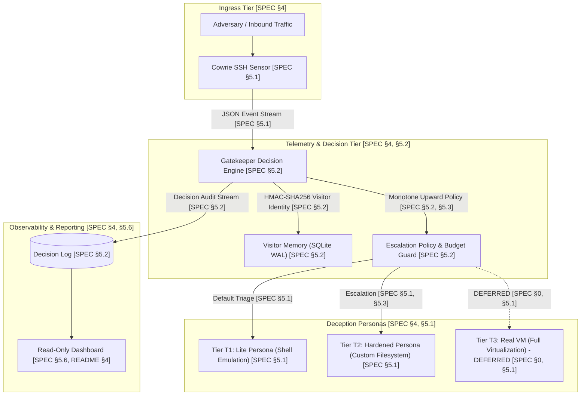

# System Architecture & Technical Glossary

This document outlines the system architecture, component data flows, and canonical terminology for Schrödinger's Server.
Every description is grounded in and traceable to the system specification [SPEC] and repository documentation [README].

---

## 1. System Architecture Diagram

---

## 2. Technical Glossary

- **Visitor**: A source identity derived via salted HMAC of the incoming IP address, ensuring privacy preservation with zero raw IP persistence in decision logs [SPEC §3, SPEC §5.2].
- **Sensor (Cowrie)**: The pinned SSH honeypot daemon that ingests inbound traffic, enforces a consistent identity profile, and publishes structured event telemetry [SPEC §5.1, README §3].
- **Gatekeeper**: The centralized decision engine responsible for extracting stage features, computing model scores, enforcing budget constraints, tracking visitor history, and assigning honeypot tiers [SPEC §5.2, README §3].
- **Tier T1 (Lite)**: Low-interaction baseline emulation shell maintaining a matched identity profile at minimum resource cost [SPEC §3, SPEC §5.1, README §3].
- **Tier T2 (Hardened)**: Medium-interaction emulation environment featuring a custom fake filesystem overlay, rich command outputs, and local decoy artifacts [SPEC §3, SPEC §5.1, README §3].
- **Tier T3 (Real VM - DEFERRED)**: High-interaction environment utilizing a proxy to sandboxed Linux virtual machine guests; explicitly marked as deferred pending hardware virtualization verification and gating [SPEC §0, SPEC §5.1, README §3].
- **Stage S1 (Handshake)**: The decision point following SSH key exchange and protocol version negotiation [SPEC §3, SPEC §5.1].
- **Stage S2 (Authentication)**: The decision point following credential submission and login verification [SPEC §3, SPEC §5.1].
- **Stage S3 (Session Setup)**: The decision point following channel allocation and pseudo-terminal or subsystem requests [SPEC §3, SPEC §5.1].
- **Stage S4 (First Command)**: The decision point immediately upon receiving the initial shell command [SPEC §3, SPEC §5.1].
- **Stage S5 (Command Burst)**: The decision point following the execution of multiple subsequent commands [SPEC §3, SPEC §5.1].
- **Model V**: The early-stage triage classifier evaluated on pre-command features to predict downstream interactive utility [SPEC §3, SPEC §5.2, README §1].
- **Escalation Budget**: A pre-declared operational ceiling restricting the fraction of sessions escalated to higher tiers to prevent resource exhaustion [SPEC §3, SPEC §5.2, README §3].
- **Gate 0**: The pre-registered empirical milestone evaluating whether learned statistical models demonstrate recall improvement over simple pre-declared baseline rules [SPEC §0, README §2].
- **Oracle Arm**: The retrospective hindsight simulation baseline that computes upper-bound yield efficiency assuming full post-hoc knowledge of session activity [SPEC §3, README §3].
- **Identity Profile**: A uniform system configuration across hostnames, distribution banners, kernel versions, and account names shared across tiers to prevent cross-tier fingerprinting [SPEC §3, SPEC §5.1, README §3].
