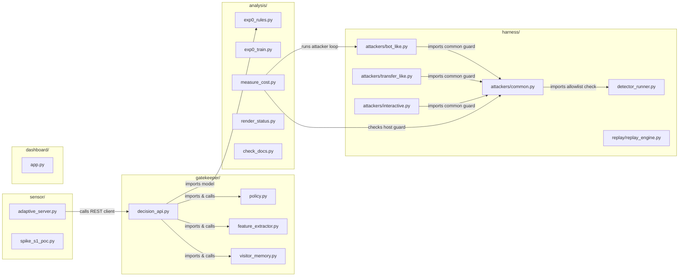
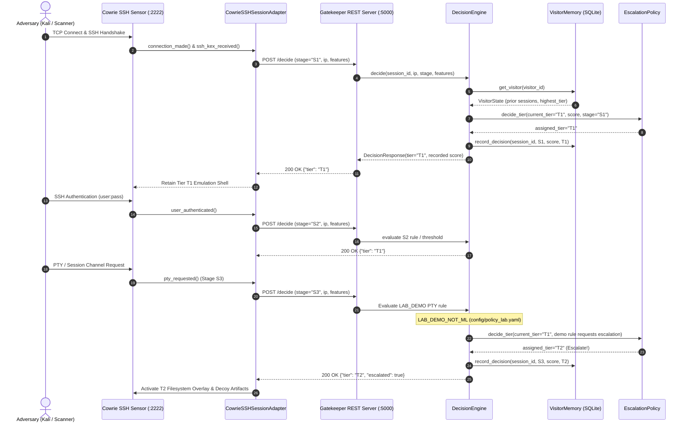

# Codebase Architecture & Dependency Graph (Graphify)

Comprehensive architectural blueprint, module dependency graph, and data-flow topology for Schrödinger's Server.
Diagrams summarize component roles. The sequence shows an illustrative LAB_DEMO flow, and deferred nodes represent proposed components. Source references describe the implementation checked in this review.

---

## 1. Complete End-to-End System Topology

```mermaid
graph TD
    %% ==========================================
    %% 1. Ingress & Adversary Lab
    %% ==========================================
    subgraph INGRESS ["1. Ingress & Adversary Lab [harness/attackers/, infra/]"]
        BOT["bot_like.py<br/>(scripted lab workload)"]
        TRANS["transfer_like.py<br/>(lab transfer workload)"]
        INTER["interactive.py<br/>(PTY lab workload)"]
        GUARD{"assert_lab_target_allowlisted()<br/>[common.py]"}
        DOCKER_PORT["Host Binding: 127.0.0.1:2222<br/>[docker-compose.yml]"]
    end

    BOT -->|calls| GUARD
    TRANS -->|calls| GUARD
    INTER -->|calls| GUARD
    GUARD -->|submits TCP packets| DOCKER_PORT

    %% ==========================================
    %% 2. Sensor & Conch Adapters
    %% ==========================================
    subgraph SENSOR_TIER ["2. Cowrie Honeypot Sensor [sensor/, infra/]"]
        COWRIE_DAEMON["Cowrie SSH Daemon v3.1.6<br/>[infra/cowrie.cfg]"]
        ID_PROFILE["identity.yaml<br/>(srv-app-01, OpenSSH_9.2p1, Debian 12)"]
        CONCH_ADAPTER["CowrieSSHSessionAdapter<br/>[sensor/adaptive_server.py]<br/>(Status: lab-verified on loopback only;<br/>see results/exp0/ASTRA2_REPORT.md and HANDOFF.md)"]
        HOOKS["Lifecycle Hooks:<br/>• ssh_version_received (S1)<br/>• user_authenticated (S2)<br/>• pty_requested (S3)<br/>• command_received (S4/S5)"]
    end

    DOCKER_PORT -->|routes| COWRIE_DAEMON
    ID_PROFILE -.->|configures| COWRIE_DAEMON
    COWRIE_DAEMON -->|subclasses Conch session| CONCH_ADAPTER
    CONCH_ADAPTER -->|triggers| HOOKS

    %% ==========================================
    %% 3. Gatekeeper Core Service
    %% ==========================================
    subgraph GATEKEEPER_TIER ["3. Gatekeeper Microservice [gatekeeper/]"]
        CLIENT["GatekeeperClient<br/>[decision_api.py]"]
        HTTP_HANDLER["GatekeeperHTTPHandler<br/>(/health, /decide, /record_session)"]
        SERVER["GatekeeperServer :5000<br/>[decision_api.py]"]
        ENGINE["DecisionEngine<br/>[decision_api.py]"]
        EXTRACTOR["SessionFeatureExtractor<br/>[feature_extractor.py]"]
        POLICY["EscalationPolicy<br/>[policy.py]"]
    end

    HOOKS -->|HTTP POST /decide| CLIENT
    CLIENT -->|REST JSON, configured lab endpoint| HTTP_HANDLER
    SERVER -->|uses handler| HTTP_HANDLER
    HTTP_HANDLER -->|calls decide()| ENGINE
    ENGINE -->|extracts features| EXTRACTOR
    ENGINE -->|evaluates tier| POLICY

    %% ==========================================
    %% 4. Models & Inference
    %% ==========================================
    subgraph INFERENCE_TIER ["4. ML Inference & Baseline Rules [analysis/, models/]"]
        MODEL_FILE[("models/model_s3.json<br/>(PurePythonLogisticRegression)")]
        LR_MODEL["PurePythonLogisticRegression<br/>[analysis/exp0_rules.py]"]
        BASELINE_RULES["Baseline Rules (R0-R7)<br/>• R1: login_success<br/>• R6: failed_logins<br/>• R7-labelled constant fallback"]
    end

    MODEL_FILE -->|deserialized by _load_model()| ENGINE
    ENGINE -->|executes predict_proba_single()| LR_MODEL
    ENGINE -->|fallback / early stages| BASELINE_RULES

    %% ==========================================
    %% 5. Persistence Tier
    %% ==========================================
    subgraph PERSISTENCE_TIER ["5. Visitor Memory & Audit Log [gatekeeper/]"]
        HMAC_DERIVE["derive_visitor_id()<br/>HMAC-SHA256(salt, raw_ip)"]
        VIS_MEMORY["VisitorMemory<br/>[visitor_memory.py]"]
        SQLITE_DB[("gatekeeper.db (WAL Mode)<br/>• visitor_memory table<br/>• decision_log table")]
    end

    ENGINE -->|derives masked ID| HMAC_DERIVE
    ENGINE -->|updates state| VIS_MEMORY
    VIS_MEMORY -->|reads/writes| SQLITE_DB
    ENGINE -->|logs decision record| SQLITE_DB

    %% ==========================================
    %% 6. Deception Personas
    %% ==========================================
    subgraph PERSONA_TIER ["6. Deception Personas [sensor/, infra/]"]
        TIER_T1["Tier T1: Lite Persona<br/>Default Cowrie Shell Emulation"]
        TIER_T2["Tier T2: Hardened Persona<br/>Custom Fake Filesystem Overlay"]
        TIER_T3["Tier T3: Real VM<br/>(QEMU Guest Pool - DEFERRED)"]
    end

    POLICY -->|decision = T1| TIER_T1
    POLICY -->|monotone escalation = T2| TIER_T2
    POLICY -.->|DEFERRED| TIER_T3
    TIER_T1 -.->|escalate upward only| TIER_T2

    %% ==========================================
    %% 7. Observability Dashboard
    %% ==========================================
    subgraph DASHBOARD_TIER ["7. Provenance Dashboard [dashboard/]"]
        DASH_SERVER["DashboardServer<br/>[dashboard/app.py]"]
        DASH_HANDLER["DashboardHandler :8080<br/>(/api/stats, /api/decisions, /api/arms)"]
        UI_SPA["index.html SPA<br/>(HTML, CSS and provenance labels)"]
    end

    SQLITE_DB -->|queries decisions (LAB/LIVE)| DASH_SERVER
    DASH_SERVER -->|serves JSON| DASH_HANDLER
    DASH_HANDLER -->|fetches asynchronously| UI_SPA

    %% ==========================================
    %% 8. Offline Empirical Pipeline
    %% ==========================================
    subgraph OFFLINE_PIPELINE ["8. Empirical Analysis & Audit Suite [analysis/]"]
        EXP0_TRAIN["exp0_train.py<br/>(Paired cluster bootstrap, Gate 0)"]
        BASE_RATES["s3_base_rates.py<br/>(Aggregate base-rate scanner)"]
        PERM_NULL["exp0_permutation_null.py<br/>(200-seed null distribution)"]
        PREFIX_STUDY["event_prefix_study.py<br/>(Event-order chronology check)"]
        CHECK_DOCS["check_docs.py<br/>(Link, path, & claim validator)"]
        RENDER_STATUS["render_status.py<br/>(Generates docs/STATUS.md)"]
        RESULTS_JSON[("results/<br/>• base_rates.json<br/>• arm_simulation.json<br/>• exp0/progress.json")]
    end

    BASE_RATES -->|writes| RESULTS_JSON
    EXP0_TRAIN -->|evaluates & writes| RESULTS_JSON
    RESULTS_JSON -->|reads metrics (RECORDED)| DASH_SERVER
    RESULTS_JSON -->|computes completion| RENDER_STATUS
    RENDER_STATUS -->|writes| STATUS_DOC["docs/STATUS.md"]
```

---

## 2. Module Call & Import Dependencies



---

## 3. Data Flow & Protocol Sequences

### Sequence 1: Inbound SSH Session Triage & Escalation


---

## 4. Subsystem Responsibilities & Boundary Invariants

| Layer | Primary Files | Core Invariants Enforced |
|---|---|---|
| **Ingress Safety** | `harness/attackers/common.py`<br/>`infra/docker-compose.yml` | The harness applies its configured lab allowlist. Docker publishes only the edge on loopback. Recorded sensor egress attempts failed (harness/detector_runner.py, infra/test_infra_configs.py, HANDOFF.md). |
| **Sensor & Conch** | `sensor/adaptive_server.py`<br/>`infra/cowrie.cfg`<br/>`config/identity.yaml` | Protocol hooks capture telemetry across stages S1 to S5. Identical identity profile (`srv-app-01`, `OpenSSH_9.2p1`, Debian 12) shared across tiers. Status: lab-verified on loopback only; see results/exp0/ASTRA2_REPORT.md and HANDOFF.md. |
| **Gatekeeper Decision Engine** | `gatekeeper/decision_api.py`<br/>`gatekeeper/policy.py`<br/>`gatekeeper/feature_extractor.py` | Tests exercise engine-exception fallback, corrupted-model fallback, monotone session and visitor tiers, and budget enforcement (gatekeeper/test_decision_api.py, gatekeeper/test_model_inference_parity.py, gatekeeper/test_policy.py, gatekeeper/test_session_budget.py). |
| **Privacy & Memory** | `gatekeeper/visitor_memory.py` | VisitorMemory derives HMAC-SHA256 identifiers with configurable salt and a public development fallback. The visitors table uses derived IDs and WAL (gatekeeper/visitor_memory.py, gatekeeper/test_visitor_memory.py). |
| **Model Inference** | `models/model_s3.json`<br/>`analysis/exp0_rules.py` | Zero external ML dependencies in production runtime: `PurePythonLogisticRegression` executes standalone matrix multiplication and sigmoid evaluation. |
| **Observability Dashboard** | `dashboard/app.py`<br/>`dashboard/templates/index.html` | Tests reject random updates, literal session arrays and selected copied base-rate values. They exercise provenance and unavailable-data responses (dashboard/test_truthfulness.py). |
| **Offline Empirical Audit** | `analysis/exp0_train.py`<br/>`analysis/render_status.py`<br/>`analysis/check_docs.py` | Pre-registered Gate 0 evaluation protocols, paired cluster bootstraps with budget recalculation, link and path hygiene validation, and deterministic progress accounting. |
